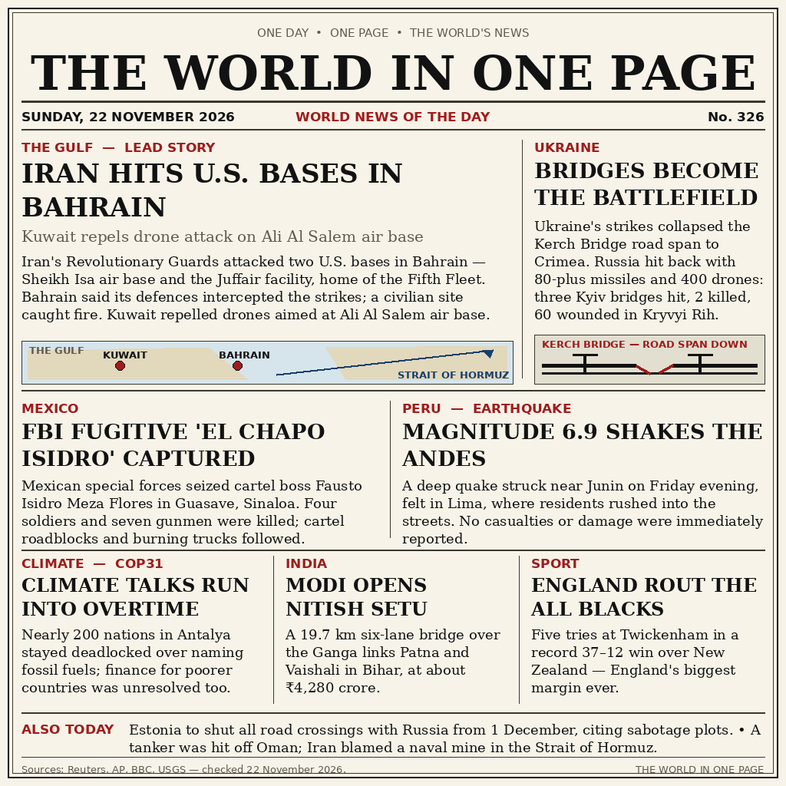

# The World in One Page — Sunday, 22 November 2026

[](https://make.fun/bounty/news-image-20261122?utm_source=github&utm_medium=readme&utm_campaign=news-image-20261122)
[](https://make.fun/bounty/news-image-20261122/leaderboard?utm_source=github&utm_medium=readme&utm_campaign=news-image-20261122)
[](https://make.fun/bounty/news-image-20261122?utm_source=github&utm_medium=readme&utm_campaign=news-image-20261122)
[](LICENSE)

A one-page newspaper front page that sums up the world's news of
**Sunday, 22 November 2026** in a single 1024×1024 image — built for the
[make.fun bounty "Sum up 22 November's world news in one image"](https://make.fun/bounty/news-image-20261122)
($100, 50 places paid: $20 / $12 / $6 / $2 ×7 / $1.20 ×40).



## What's on the page

| Panel | Story |
|---|---|
| **Lead story** | Iran's Revolutionary Guards hit two U.S. bases in Bahrain (Sheikh Isa air base and the Juffair naval facility, home of the Fifth Fleet); Kuwait repelled drones aimed at Ali Al Salem air base. A tanker was hit off Oman in the Strait of Hormuz. |
| **Ukraine** | Ukraine's strikes collapsed the Kerch Bridge road span to Crimea; Russia hit back with 80-plus missiles and 400 drones — three Kyiv bridges hit, 2 killed and 60 wounded in Kryvyi Rih. |
| **Mexico** | FBI fugitive "El Chapo Isidro" (Fausto Isidro Meza Flores) captured in a raid on Guasave, Sinaloa; 4 soldiers and 7 gunmen killed, cartel roadblocks followed. |
| **Peru** | Magnitude 6.9 earthquake shakes the Andes near Junin, felt in Lima; no casualties or damage immediately reported. |
| **Climate** | COP31 talks in Antalya run into overtime, deadlocked over naming fossil fuels and finance for poorer countries. |
| **India** | PM Modi opens the Nitish Setu — a 19.7 km six-lane bridge over the Ganga linking Patna and Vaishali, about ₹4,280 crore. |
| **Sport** | England rout the All Blacks 37–12 at Twickenham, a record margin. |
| **Also today** | Estonia to shut all road crossings with Russia from 1 December, citing sabotage plots. |

## Sources (checked 22 Nov 2026)

- Gulf / Bahrain / Kuwait: BBC, Reuters, Fars News Agency via ZeroHedge
- Ukraine / Kerch Bridge / Kryvyi Rih: AP, BBC
- Mexico capture: Reuters, CNN, Wall Street Journal
- Peru earthquake: Reuters, U.S. Geological Survey
- COP31: Reuters
- Nitish Setu: Press Information Bureau of India, IANS
- England 37–12 New Zealand: Reuters
- Estonia border: CNN, Estonian government announcement

## How it works

`main.ts` (Node 22, standard library only) copies the pre-rendered front
page `entry.png` to the output directory. The image itself is drawn by
`tools/generate_image.py` (Pillow, run during the build session) — a
deterministic newspaper layout: masthead, lead story with a schematic Gulf
map, and six more news panels plus an "also today" strip. The program uses
no network and writes the same bytes on every run.

```sh
mkdir -p out && MAKEFUN_OUTPUT_DIR=out node main.ts   # writes out/entry.png
python3 tools/generate_image.py                        # redraw entry.png
```

Output: one PNG, 1024×1024, under 1 MiB.

## License

MIT — see [LICENSE](LICENSE).
